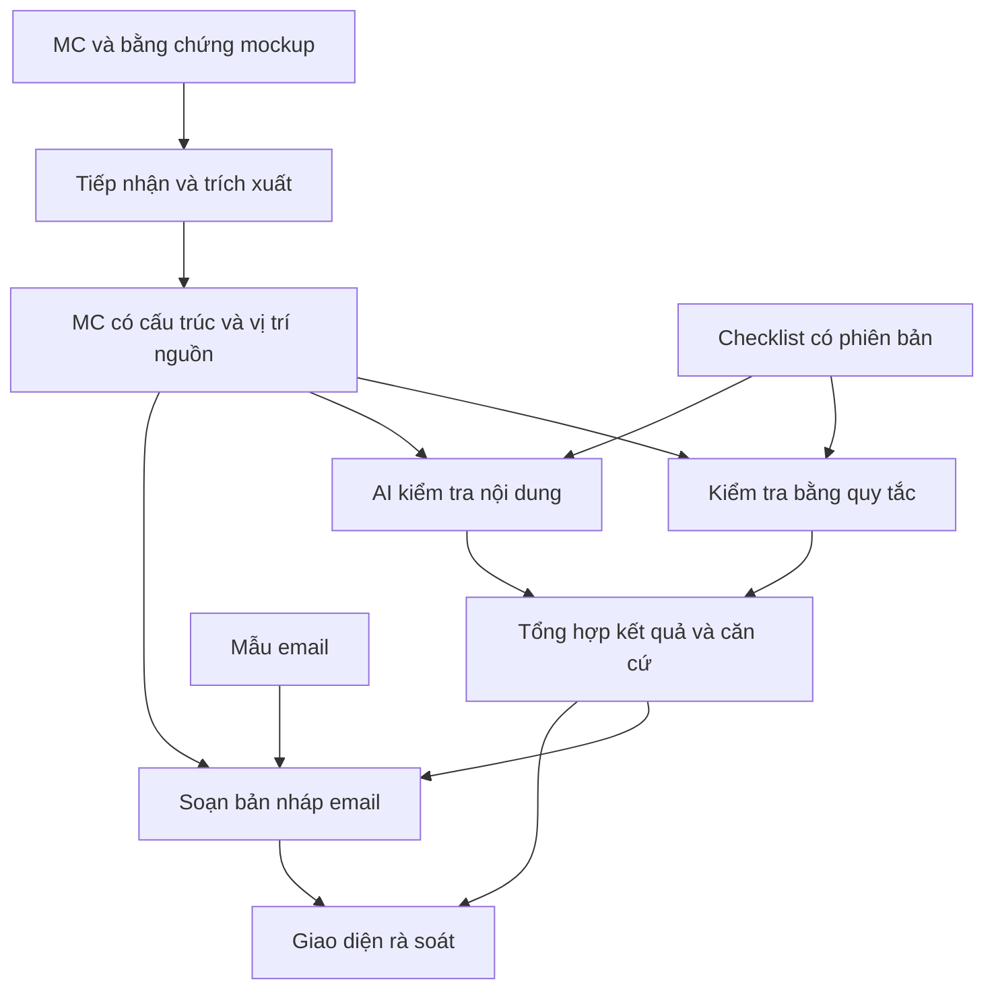

# Kế hoạch MVP — AI Gate hỗ trợ quy trình CIP

- Thực tập sinh: Nguyễn Đức Anh — Cặp C.
- Mentor: MinhLQ11.
- Cập nhật: 03/11/2026.
- Trạng thái: Kế hoạch phục vụ Gate 0.
- Gate 0: chiều 04/11/2026.

## 1. Vấn đề, người dùng và giá trị

CIP là quy trình cần thực hiện trước khi go-live. MC document được lập theo template trên Confluence để phục vụ quy trình CIP. Công cụ cần hỗ trợ kiểm tra MC và soạn bản nháp email xin phê duyệt.

Người dùng trực tiếp là người chuẩn bị hồ sơ CIP: cung cấp nội dung MC, xem kết quả kiểm tra, bổ sung thông tin và rà soát email.

Giả thuyết giá trị: công cụ giúp giảm thời gian kiểm tra hồ sơ và soạn email, phát hiện thông tin thiếu hoặc mâu thuẫn trước khi gửi duyệt, đồng thời cung cấp căn cứ để người dùng kiểm tra lại. Chưa có số liệu hiện trạng để kết luận mức cải thiện.

## 2. Đầu vào và luồng sử dụng

Toàn bộ giá trị cụ thể, tài khoản, liên kết, email và tệp mẫu phục vụ phát triển sẽ tự dựng; không chờ tiếp cận dữ liệu hoặc tài liệu nội bộ thật.

| Mục trong MC đã xác nhận | Kiểu dữ liệu | Cách dựng mockup |
| --- | --- | --- |
| Ticket Jira | Link | URL giả lập, ví dụ `https://jira.example.test/browse/DEMO-001`; không cần gọi Jira thật |
| Service | Văn bản | Tên dịch vụ giả lập, ví dụ `Demo Notification Service` |
| Type | Văn bản | Giá trị tự định nghĩa trong danh mục mockup, ghi rõ không phải phân loại nội bộ chính thức |
| Risk | Văn bản | Mô tả rủi ro giả lập; mức phân loại nếu có là giả định của MVP |
| BO sign-off | Tệp .msg | Email xác nhận giả lập, người gửi và nội dung tự dựng |
| Request | Tệp .msg | Email yêu cầu giả lập, có thông tin nhất quán với MC |

Ví dụ trên chỉ minh họa thiết kế dữ liệu, chưa phải bộ mockup đã tạo. Các tệp .msg cần đúng định dạng và đọc được; không đổi đuôi tệp văn bản thành .msg. Cách tạo và đọc tệp sẽ được kiểm chứng ở giai đoạn skeleton.

Checklist kiểm tra và mẫu email do dự án đề xuất cho MVP, tách rõ quy tắc mockup với thông tin nghiệp vụ đã xác nhận. Không coi quy tắc tự dựng là quy định CIP chính thức. Cấu trúc bố cục Confluence sẽ tự mô phỏng từ sáu mục trên, không cần template nội bộ thật. Checklist/prompt/mẫu email cần quản lý phiên bản; lỗi đọc và lỗi LLM phải phân biệt với kết luận nghiệp vụ.

Luồng đề xuất:

1. Nhận nội dung MC và bằng chứng mockup liên quan.
2. Trích xuất các mục, trường và vị trí nguồn.
3. Kiểm tra bằng quy tắc và AI theo checklist đã xác nhận.
4. Hiển thị tiêu chí đạt, chưa đạt, cần xem xét; kèm căn cứ và gợi ý bổ sung.
5. Soạn bản nháp email; đánh dấu thông tin còn thiếu.
6. Người dùng rà soát trước khi sử dụng kết quả và email.

Việc T4 làm UAT và T3 viết CR gửi T2 là bối cảnh đã biết. Chưa suy diễn thành thứ tự đầy đủ của quy trình CIP hoặc điều kiện phê duyệt.

## 3. Phạm vi MVP đề xuất

| Trong phạm vi | Kết quả mong đợi |
| --- | --- |
| Một template MC mockup tự dựng theo sáu mục đã xác nhận, một phương thức đầu vào | Nhận diện được các mục và tệp đính kèm |
| Kiểm tra trường bắt buộc | Liệt kê mục thiếu hoặc chưa điền |
| Kiểm tra tính nhất quán theo quy tắc đã xác nhận | Chỉ ra thông tin xung đột kèm căn cứ |
| AI kiểm tra nội dung theo checklist | Nhận xét có trích đoạn; thiếu căn cứ thì chuyển cần xem xét |
| Báo cáo kiểm tra | Trạng thái từng tiêu chí và gợi ý xử lý |
| Sinh email theo mẫu | Bản nháp dùng thông tin có trong hồ sơ, đánh dấu phần thiếu |
| Đánh giá trên mockup | Đối chiếu với đáp án kỳ vọng, ghi phiên bản cấu hình và thời gian |

Ngoài phạm vi đề xuất: tự gửi email, tự phê duyệt, ghi lên Confluence/Jira, tra cứu hệ thống nội bộ thật và hỗ trợ nhiều template.

## 4. Success metric và rubric đánh giá

### 4.1. Metric và ngưỡng mục tiêu

| Metric | Cách đo | Ngưỡng mục tiêu |
| --- | --- | --- |
| Precision phát hiện thiếu | TP / (TP + FP) | ≥ 90% |
| Recall phát hiện thiếu | TP / (TP + FN) | ≥ 90% |
| Độ đúng căn cứ | Số căn cứ đúng / tổng căn cứ được trả ra | ≥ 95% |
| Email đạt checklist | Số email đạt mọi tiêu chí / tổng email sinh thành công | ≥ 90% |
| Email có thông tin thiếu căn cứ | Số email có ít nhất một khẳng định thiếu căn cứ / tổng email sinh thành công | Không quan sát email thiếu căn cứ trên bộ đánh giá; không suy rộng thành bảo đảm ngoài bộ này |
| Giảm thời gian hoàn thành | (Trung vị thời gian thủ công − trung vị thời gian có công cụ) / trung vị thời gian thủ công | ≥ 20% |

Đơn vị TP/FP/FN là cặp `(case_id, criterion_id)`: TP là mục thiếu được phát hiện đúng; FP là mục không thiếu bị cảnh báo thiếu; FN là mục thiếu bị bỏ sót. Mẫu số bằng 0 ghi N/A kèm số đếm, không quy đổi thành 100%. Lỗi đọc và lỗi sinh email được thống kê riêng, cùng tổng case đủ điều kiện và tổng case xử lý thành công.

Checklist email gồm: đúng thông tin hồ sơ; đúng trạng thái kiểm tra; thể hiện các mục cần bổ sung; không tự thêm người nhận hoặc phê duyệt; không bịa dữ liệu; nội dung yêu cầu rõ ràng. Người rà soát ghi nhãn đạt/không đạt cùng lý do.

Phép đo thời gian dùng cùng bộ hồ sơ và người thực hiện, tính cả thời gian rà soát và sửa email; cân bằng thứ tự thủ công/có công cụ để giảm ảnh hưởng ghi nhớ. Báo cáo ghi số mẫu, điều kiện đo và phiên bản checklist/prompt/cấu hình LLM. Baseline được đo tại Gate 1; các ngưỡng trên là mục tiêu đánh giá của MVP.

### 4.2. Rubric mức 2–3–4

Rubric áp dụng cho checkpoint; Gate 0 và Gate 1 đánh giá theo đạt/chưa đạt.

| Tiêu chí | 2 — Đạt | 3 — Tốt | 4 — Xuất sắc |
| --- | --- | --- | --- |
| Giá trị và kết quả | Chạy đủ luồng kiểm tra và email; precision/recall ≥ 80%, email đạt checklist ≥ 80% trên tập được phép; thể hiện rõ lỗi xử lý. | Đạt toàn bộ ngưỡng mục 4.1 trên dữ liệu masked được cấp và được phép dùng; có ít nhất một stakeholder dùng thử và ghi nhận phản hồi. | Precision/recall ≥ 95%, email đạt checklist ≥ 95%, căn cứ đúng ≥ 98%, giảm thời gian ≥ 30%, không quan sát email thiếu căn cứ; stakeholder xác nhận muốn đưa MVP đi tiếp. |
| Chất lượng kỹ thuật | Có hướng dẫn chạy, schema và cấu hình có phiên bản; cả sáu nhóm mockup có đầu ra đối chiếu đáp án; mã nguồn đọc hiểu được. | Bộ đánh giá chạy lại bằng một lệnh; kiểm tra schema/lỗi, lưu kết quả từng case và cấu hình LLM; đánh giá có hệ thống phần AI và tuân thủ dữ liệu. | Ít nhất một người khác chạy lại theo tài liệu và thêm một rule hoặc case mà không cần hướng dẫn trực tiếp; có minh chứng bàn giao và kết quả regression. |
| Thực thi và chủ động | Hoàn thành ≥ 80% đầu việc đến hạn đã chốt, có bằng chứng. | Hoàn thành ≥ 90%; báo rủi ro ngay khi ghi nhận và trước hạn bị ảnh hưởng; ghi hướng xử lý góp ý trong hai ngày làm việc. | Đạt mức 3; có ít nhất một điều chỉnh kế hoạch dựa trên số liệu và một đóng góp giúp đồng đội được xác nhận. |

CP1 đánh giá trên mockup; CP2/CP3 dùng masked khi được cấp và được phép sử dụng. Nếu không có masked, cần thống nhất phương án đánh giá thay thế trước checkpoint và ghi rõ phạm vi dữ liệu khi báo cáo. Thay đổi phạm vi công việc phải được ghi nhận trước hạn và thống nhất khi tính tỷ lệ hoàn thành.

## 5. Kiến trúc sơ bộ

Đề xuất skeleton nhận HTML mockup mô phỏng trang Confluence cùng hai tệp .msg giả lập. Nội dung trang, tệp và liên kết đều tự dựng; các link Jira/Confluence giả không cần truy cập mạng. Tích hợp Confluence thật không phải điều kiện để phát triển hoặc demo MVP. Cách đóng gói đầu vào và công cụ đọc .msg sẽ được kiểm chứng ở giai đoạn skeleton.

| Thành phần | Trách nhiệm |
| --- | --- |
| Tiếp nhận, trích xuất | Kiểm tra định dạng; đọc tiêu đề, bảng, trường; giữ vị trí nguồn |
| Bộ quy tắc | Xử lý điều kiện xác định, trường bắt buộc và định dạng |
| AI kiểm tra | Đọc hiểu theo checklist, trả nhận xét có căn cứ |
| Tổng hợp | Chuẩn hóa kết quả; đánh dấu thiếu dữ liệu, lỗi xử lý và kết quả xung đột |
| Soạn email | Điền mẫu từ dữ liệu có căn cứ, đánh dấu phần thiếu |
| Giao diện | Xem lỗi, căn cứ và sao chép bản nháp |
| Bộ đánh giá | So sánh với đáp án mockup, ghi nhận kết quả và thời gian |

Kết quả mỗi tiêu chí đề xuất gồm: `criterion_id`, `status` (`pass`, `fail`, `needs_review`), `reason`, `evidence` (trích đoạn và vị trí), `suggestion`, `checker`, `checklist_version`.

Nguyên tắc: không đọc được tài liệu không được mặc định là đạt; kết quả AI phải đúng cấu trúc; không tự tạo người phê duyệt hoặc thông tin còn thiếu. Checklist và mẫu email được quản lý riêng, có phiên bản. Lựa chọn công nghệ cụ thể và công cụ AI cần xác nhận tính khả dụng trước khi chốt.

Giả định rủi ro nhất đề xuất cho Gate 1: có thể trích xuất MC đủ chính xác để kiểm tra theo checklist và dẫn căn cứ đúng vị trí. Kiểm chứng trên mockup có bảng, mục thiếu và thông tin mâu thuẫn, đối chiếu với đáp án kỳ vọng. Nếu trích xuất không chắc chắn hoặc không đọc được, báo lỗi/`needs_review`, không mặc định đạt.

## 6. Lộ trình và việc còn mở

| Mốc | Đầu ra |
| --- | --- |
| Gate 0 — 04/11 | Kế hoạch, rubric, pair contract v0, đặc tả mockup, rủi ro và phụ thuộc |
| Gate 1 — 11/11 | Skeleton xuyên suốt, kiểm chứng giả định, baseline, backlog Sprint 1 |
| CP1 — 18/11 | Demo MVP trên mockup và tiến độ |
| CP2 — 25/11 | MVP trên masked, kết quả Sprint 1, retro |
| CP3 — 09/12 | Final demo, metric và bàn giao |

### Bộ dữ liệu phục vụ phát triển và đánh giá

Đặc tả mockup đề xuất trong bộ tài liệu dự án là 24 gói: 12 gói phát triển/kiểm chứng sớm và 12 gói đánh giá giữ riêng; mỗi tập có hai gói cho mỗi nhóm: đầy đủ, thiếu mục/trường, thiếu bằng chứng, sai định dạng/lỗi đọc, không nhất quán và biến thể bố cục. Mỗi gói có manifest, HTML MC, tệp .msg nếu có và đáp án gồm giá trị/trạng thái/căn cứ. Đây là kế hoạch dữ liệu, chưa phải bộ dữ liệu đã tạo; checklist và nhãn được rà soát trước khi dùng để đánh giá. Tập đánh giá không dùng làm ví dụ prompt; nếu đã dùng để chỉnh hệ thống thì thay tập trước khi báo cáo đánh giá độc lập.

## 7. Rủi ro và phụ thuộc

| ID | Rủi ro / phụ thuộc | Ảnh hưởng và xử lý đề xuất |
| --- | --- | --- |
| R-01 | Checklist hoặc điều kiện hợp lệ chưa rõ | Kết luận đủ/thiếu có thể sai; rà từng tiêu chí, ghi điều kiện đạt và phiên bản checklist. |
| R-02 | Trích xuất HTML/.msg sai hoặc thiếu | Sai dữ liệu/căn cứ; đối chiếu đáp án, giữ vị trí nguồn, báo lỗi hoặc `needs_review`. |
| R-03 | LLM thêm thông tin hoặc sai schema | Báo cáo/email không đáng tin; kiểm tra schema, đối chiếu nguồn, đánh dấu thiếu dữ liệu và đo trên mockup. |
| R-05 | Mockup thiếu tình huống hoặc nhãn sai | Metric không đại diện; phủ đủ sáu nhóm, rà đáp án và tách tập phát triển/đánh giá. |
| R-07 | So sánh thời gian không công bằng | Kết luận tiết kiệm thời gian không đáng tin; dùng cùng hồ sơ/người làm, cân bằng thứ tự và tính cả rà soát/sửa. |
| R-08 | Chưa có cách xác định cấp bậc nhân viên | Chưa đủ căn cứ kiểm tra cấp bậc/vai trò; xác định nguồn phù hợp, dùng bảng ánh xạ giả lập cho MVP và chuyển cần xác nhận khi thiếu, không suy đoán. |
| D-01 | Thống nhất pair contract và giao diện tích hợp với Vĩnh | Ranh giới, schema trao đổi và mốc tích hợp có thể chưa chốt; dùng phương án đề xuất, ghi rõ phần hai bên xác nhận. |
| D-02 | Quy tắc CIP/mẫu email và dữ liệu masked phụ thuộc mentor | Không dùng giả định thành chính sách; MVP tiếp tục bằng mockup. Chỉ dùng masked từ 19/11 nếu được cấp và cho phép, lưu theo hướng dẫn, không commit. |

Phạm vi phát triển hiện tại sử dụng hoàn toàn dữ liệu tự dựng theo xác nhận của Nguyễn Đức Anh. Kế hoạch chương trình có mốc dữ liệu masked từ 19/11; nếu sau này mentor cung cấp thì chỉ dùng trong phạm vi được phép, lưu riêng và không commit. Không phụ thuộc việc có masked để dựng MVP và không dùng dữ liệu thật.

Các vấn đề nghiệp vụ cần làm rõ:

- Sáu mục MC đã rõ; cần đề xuất và thống nhất tiêu chí bắt buộc, hợp lệ và nhất quán trên bộ mockup, không yêu cầu template hoặc hồ sơ thật.
- Ai trực tiếp sử dụng công cụ? T2 nhận và phê duyệt theo điều kiện nào?
- CR, kết quả UAT và MC liên kết với nhau ở đâu, bằng bằng chứng gì?
- BO sign-off và Request có bắt buộc không? MVP có cần đọc nội dung .msg?
- Mẫu email tự dựng, người nhận/CC giả lập và danh sách đính kèm đề xuất có phù hợp phạm vi MVP không?
- Phương án nhận HTML mockup và tệp .msg có phù hợp không? Công cụ AI nào được phép sử dụng?
- Ai rà soát tính hợp lý của đáp án mockup và ngưỡng thành công?

## Nguồn

- [Tài liệu dự án CIP](00-confluence-project-documentation.md), mục 5.3, 6.4 và 7.2–7.3.
- [Kế hoạch thực tập 6 tuần](../../Kế%20hoạch%20thực%20tập%206%20tuần.pdf).
- [Theo dõi tiến độ Cặp C](../../Theo_doi_tien_do_thuc_tap(Cặp%20C).csv).
- [Ảnh ghi chú nghiệp vụ](../../Pasted%20image.png), đọc cùng các đính chính của Nguyễn Đức Anh trong chat ngày 02/11/2026.
