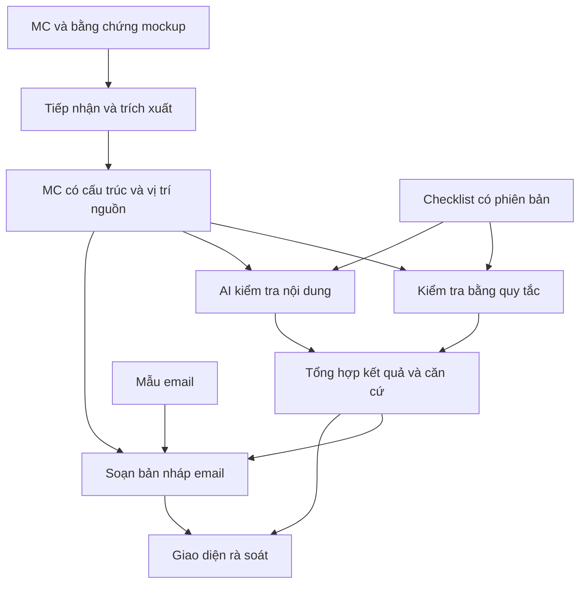

# Kế hoạch MVP — AI Gate hỗ trợ quy trình CIP

- Thực tập sinh: Nguyễn Đức Anh — Cặp C.
- Mentor: MinhLQ11.
- Cập nhật: 02/11/2026.
- Trạng thái: Bản nháp phục vụ Gate 0, chưa được mentor duyệt.
- Đầu việc: C2-001, C2-002.
- Gate 0: chiều 04/11/2026.

## 1. Vấn đề, người dùng và giá trị

CIP là quy trình cần thực hiện trước khi go-live. MC document được lập theo template trên Confluence để phục vụ quy trình CIP. Công cụ cần hỗ trợ kiểm tra MC và soạn bản nháp email xin phê duyệt.

Người dùng trực tiếp dự kiến là người chuẩn bị hồ sơ CIP: cung cấp nội dung MC, xem kết quả kiểm tra, bổ sung thông tin và rà soát email. Cần mentor xác nhận chức danh và trách nhiệm cụ thể của người dùng này.

| Thông tin đã xác nhận | Nội dung |
| --- | --- |
| Cấp bậc | Số càng nhỏ, cấp bậc càng cao: T2 > T3 > T4 |
| T4 | Thực hiện UAT |
| T3 | Viết CR để gửi T2 |
| T2 | Nhận CR từ T3; điều kiện phê duyệt chưa được xác nhận |
| MC | Sử dụng template trên Confluence |

Giả thuyết giá trị: công cụ giúp giảm thời gian kiểm tra hồ sơ và soạn email, phát hiện thông tin thiếu hoặc mâu thuẫn trước khi gửi duyệt, đồng thời cung cấp căn cứ để người dùng kiểm tra lại. Chưa có số liệu hiện trạng để kết luận mức cải thiện.

## 2. Đầu vào và luồng sử dụng

| Đầu vào dự kiến | Cách sử dụng | Tình trạng |
| --- | --- | --- |
| Nội dung MC | Nguồn chính để kiểm tra và soạn email | Đã xác nhận dùng Confluence; chưa có template chi tiết |
| Ticket Jira, Service, Type, Risk | Kiểm tra sự hiện diện và nội dung theo checklist | Đọc từ ảnh ghi chú; cần xác nhận yêu cầu từng trường |
| BO sign-off, Request dạng .msg | Bằng chứng liên quan | Đọc từ ảnh ghi chú; cần xác nhận tính bắt buộc và phạm vi xử lý |
| Checklist CIP | Định nghĩa điều kiện kiểm tra | Chờ mentor xác nhận |
| Mẫu email | Cấu trúc và thông tin bắt buộc | Chờ cung cấp mẫu trống hoặc mockup |

Luồng đề xuất:

1. Nhận nội dung MC và bằng chứng mockup liên quan.
2. Trích xuất các mục, trường và vị trí nguồn.
3. Kiểm tra bằng quy tắc và AI theo checklist đã xác nhận.
4. Hiển thị tiêu chí đạt, chưa đạt, cần xem xét; kèm căn cứ và gợi ý bổ sung.
5. Soạn bản nháp email; đánh dấu thông tin còn thiếu.
6. Người dùng rà soát trước khi sử dụng kết quả và email.

Việc T4 làm UAT và T3 viết CR gửi T2 là bối cảnh đã biết. Chưa suy diễn thành thứ tự đầy đủ của quy trình CIP hoặc điều kiện phê duyệt.

## 3. Phạm vi MVP đề xuất

| Trong phạm vi | Kết quả mong đợi |
| --- | --- |
| Một phiên bản template MC, một phương thức đầu vào | Nhận diện được các mục đã thống nhất |
| Kiểm tra trường bắt buộc | Liệt kê mục thiếu hoặc chưa điền |
| Kiểm tra tính nhất quán theo quy tắc đã xác nhận | Chỉ ra thông tin xung đột kèm căn cứ |
| AI kiểm tra nội dung theo checklist | Nhận xét có trích đoạn; thiếu căn cứ thì chuyển cần xem xét |
| Báo cáo kiểm tra | Trạng thái từng tiêu chí và gợi ý xử lý |
| Sinh email theo mẫu | Bản nháp dùng thông tin có trong hồ sơ, đánh dấu phần thiếu |
| Đánh giá trên mockup | Đối chiếu với đáp án kỳ vọng |

Ngoài phạm vi đề xuất: tự gửi email, tự phê duyệt, ghi lên Confluence/Jira, tra cứu hệ thống nội bộ thật và hỗ trợ nhiều template.

## 4. Success metric dự kiến

| Metric | Cách đo dự kiến |
| --- | --- |
| Khả năng phát hiện lỗi | Số lỗi phát hiện đúng / tổng lỗi đã gắn nhãn |
| Chất lượng cảnh báo | Số cảnh báo đúng / tổng cảnh báo do công cụ đưa ra |
| Độ đúng của căn cứ | Số kết luận có căn cứ đúng / tổng kết luận cần căn cứ |
| Chất lượng email | Đánh giá độ đầy đủ, chính xác và lượng chỉnh sửa theo checklist email |
| Thời gian xử lý | So sánh thời gian kiểm tra và soạn email có/không có công cụ trên cùng bộ hồ sơ |

Ngưỡng mục tiêu, cách xử lý mẫu số bằng 0, bộ đánh giá và rubric mức 2–3–4 sẽ được xây dựng tại C2-004 ngày 03/11 và trình mentor duyệt. Chưa có baseline thực đo.

## 5. Kiến trúc sơ bộ

Đề xuất skeleton nhận HTML mockup mô phỏng trang Confluence. Đây là lựa chọn tạm thời để kiểm chứng luồng; chưa chốt tích hợp API hoặc phương thức đầu vào chính thức.

| Thành phần | Trách nhiệm |
| --- | --- |
| Tiếp nhận, trích xuất | Kiểm tra định dạng; đọc tiêu đề, bảng, trường; giữ vị trí nguồn |
| Bộ quy tắc | Xử lý điều kiện xác định, trường bắt buộc và định dạng |
| AI kiểm tra | Đọc hiểu theo checklist, trả nhận xét có căn cứ |
| Tổng hợp | Chuẩn hóa kết quả; đánh dấu thiếu dữ liệu, lỗi xử lý và kết quả xung đột |
| Soạn email | Điền mẫu từ dữ liệu có căn cứ, đánh dấu phần thiếu |
| Giao diện | Xem lỗi, căn cứ và sao chép bản nháp |
| Bộ đánh giá | So sánh với đáp án mockup, ghi nhận kết quả và thời gian |

Kết quả mỗi tiêu chí đề xuất gồm: `criterion_id`, `status` (`pass`, `fail`, `needs_review`), `reason`, `evidence` (trích đoạn và vị trí), `suggestion`, `checker`, `checklist_version`.

Nguyên tắc: không đọc được tài liệu không được mặc định là đạt; kết quả AI phải đúng cấu trúc; không tự tạo người phê duyệt hoặc thông tin còn thiếu. Checklist và mẫu email được quản lý riêng, có phiên bản. Lựa chọn công nghệ cụ thể và công cụ AI cần xác nhận tính khả dụng trước khi chốt.

Giả định rủi ro nhất đề xuất cho Gate 1: có thể trích xuất MC đủ chính xác để kiểm tra theo checklist và dẫn căn cứ đúng vị trí. Kiểm chứng trên mockup có bảng, mục thiếu và thông tin mâu thuẫn, đối chiếu với đáp án kỳ vọng.

## 6. Lộ trình và việc còn mở

| Mốc | Đầu ra |
| --- | --- |
| Gate 0 — 04/11 | Kế hoạch, rubric, pair contract v0, đặc tả mockup, rủi ro và phụ thuộc |
| Gate 1 — 11/11 | Skeleton xuyên suốt, kiểm chứng giả định, baseline, backlog Sprint 1 |
| CP1 — 18/11 | Demo MVP trên mockup và tiến độ |
| CP2 — 25/11 | MVP trên masked, kết quả Sprint 1, retro |
| CP3 — 09/12 | Final demo, metric và bàn giao |

Đến CP1 chỉ dùng mockup tự dựng. Sau đó dùng masked do mentor cung cấp trong phạm vi được phép; không commit masked. Không dùng dữ liệu thật.

Câu hỏi cần chốt với mentor:

- Template MC trống, các mục bắt buộc và checklist cụ thể là gì?
- Ai trực tiếp sử dụng công cụ? T2 nhận và phê duyệt theo điều kiện nào?
- CR, kết quả UAT và MC liên kết với nhau ở đâu, bằng bằng chứng gì?
- BO sign-off và Request có bắt buộc không? MVP có cần đọc nội dung .msg?
- Mẫu email, người nhận, CC và tài liệu đính kèm được xác định thế nào?
- Nhận nội dung Confluence bằng cách nào? Công cụ AI nào được phép sử dụng?
- Ai xác nhận đáp án đánh giá và ngưỡng thành công?

## Nguồn

- [Kế hoạch thực tập 6 tuần](../../Kế%20hoạch%20thực%20tập%206%20tuần.pdf).
- [Theo dõi tiến độ Cặp C](../../Theo_doi_tien_do_thuc_tap(Cặp%20C).csv).
- [Ảnh ghi chú nghiệp vụ](../../Pasted%20image.png), đọc cùng các đính chính của Nguyễn Đức Anh trong chat ngày 02/11/2026.

Tài liệu này chưa phải bộ Gate 0 hoàn chỉnh. Metric/rubric chi tiết, đặc tả mockup và danh sách rủi ro riêng thuộc kế hoạch ngày 03/11.
